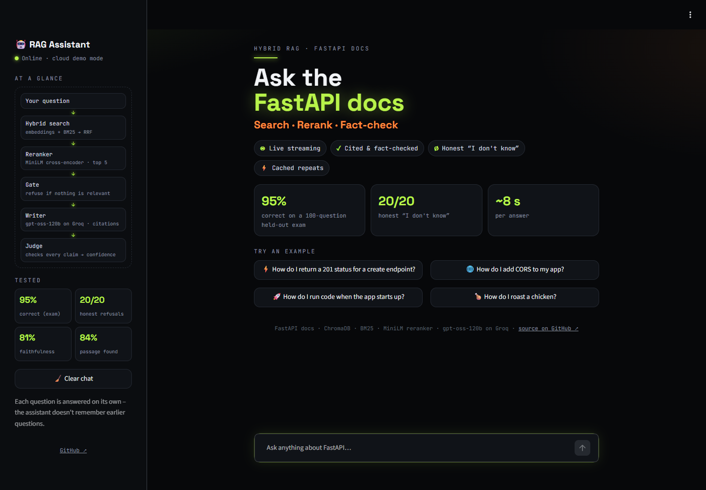
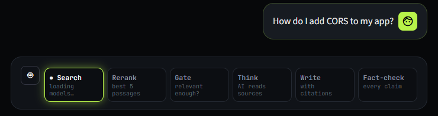
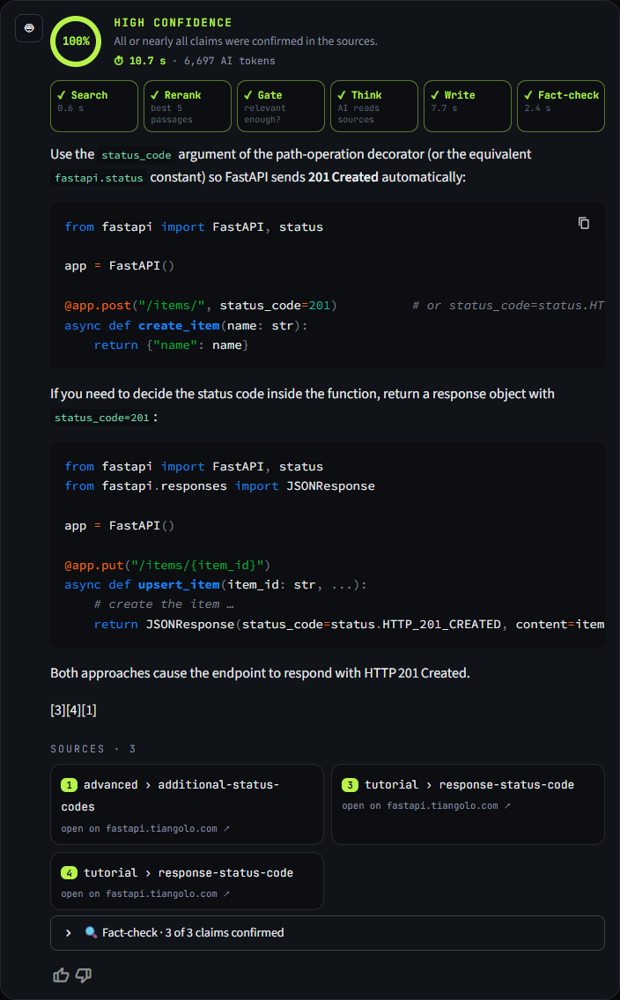
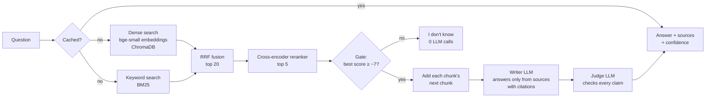

# Hybrid RAG over the FastAPI docs

[](https://github.com/vedududu/hybrid-rag/actions/workflows/tests.yml)

A question-answering assistant for the FastAPI documentation. Every answer comes **only** from the docs, with citations and a claim-by-claim fact-check. When the docs don't cover a question, it says **"I don't know"** instead of inventing an answer.

**Live demo:** https://hybrid-rag-vedu.streamlit.app/
<sub>Free hosting: if nobody has visited for 12 hours the app is asleep. Click "Yes, get this app back up!", and give the first question 1–2 minutes while the AI models load.</sub>



---

## Results at a glance

These results come from a **held-out exam of 100 questions** that was never used for tuning: 80 the docs can answer and 20 they can't.

| Metric | Result |
|---|---|
| Correct answers, all 100 questions | **95%** |
| Correct answers, the 80 answerable questions | **94%** (75 / 80) |
| Honest "I don't know" on the 20 unanswerable questions | **20 / 20** |
| Faithfulness (share of claims backed by the cited sources) | **81%** |
| HIGH-confidence answers that were actually correct | **52 / 55** |
| The passage holding the answer reaches the writer | **84%** (chunk level, see below) |
| Cost per answered question | **≈ 4,300 tokens ≈ $0.001** (refusals by the Gate: $0) |

What went wrong, how it was measured, and the honest caveats are covered in [Evaluation](#evaluation).

---

## What it looks like

While it works, the page shows each step live: search, rerank, gate, the AI's thinking, the answer typing out, and the fact-check.



The finished answer comes with a confidence ring, the time and tokens it took, numbered citations, source cards linking to the official docs, and the fact-check:



**Features:**
- **Chat layout** with example questions and a "Clear chat" button.
- **Live progress**: the steps, the model's reasoning and the answer stream in as they happen (`POST /ask/stream`, newline-delimited JSON).
- **Cache**: repeated questions are answered instantly with zero AI calls (exact match after normalising case, spaces and punctuation; 24 h, 500 entries).
- **👍 / 👎 feedback**, stored in Supabase (insert-only, row-level security) or in a local file.
- **12 automated tests** that run on every push with GitHub Actions. They need no API key and no internet.

---

## How it works



| Step | What happens | Details |
|---|---|---|
| **1. Ingestion** | The FastAPI docs (156 Markdown pages) are loaded. Code placeholders are expanded with the real example code, and the text is split into chunks. | 800-character chunks with 100 overlap. Near-duplicates (≥ 0.98 similarity) and tiny chunks are removed. **2,667 chunks** in total. |
| **2. Hybrid search** | Two searches run side by side. Meaning-based search finds rephrased questions ("return a 404" ≈ `HTTPException`). Keyword search catches exact names like `OAuth2PasswordRequestForm`. | `BAAI/bge-small-en-v1.5` (384-dim) in ChromaDB, plus BM25. The two lists are merged with **Reciprocal Rank Fusion** (k = 60), which only uses rank positions, so the two incompatible score scales never need to be compared. |
| **3. Reranking** | A cross-encoder reads the question *together with* each of the 20 candidates and keeps the best 5. | `cross-encoder/ms-marco-MiniLM-L-6-v2`. It is slower but more accurate than embedding search, so it only runs on the shortlist. |
| **4. Gate** | If even the best chunk scores below a threshold, the system answers "I don't know" without calling the LLM. | Threshold −7. Off-topic questions cost **zero** LLM calls and take about 1 second. |
| **5. Next chunk** | Each of the 5 chunks is extended with the chunk that follows it in the same file. | Fixes answers that were cut at a chunk boundary (see [the measurements](#the-next-chunk-upgrade)). Adding the *previous* chunk was also tested and helped nothing. |
| **6. Writer** | An LLM answers using **only** the 5 numbered sources, cites them as `[1]`, `[2]`, …, and must say "I don't know" if they don't contain the answer. | `openai/gpt-oss-120b` on Groq, temperature 0, streamed. Citation styles the model sometimes invents (`【1】`, `【1†L4-L9】`) are normalised in code. |
| **7. Judge** | A second LLM call splits the answer into claims and checks each one against the sources it cites. Code also flags citations that point to sources which don't exist. | **Confidence = share of claims confirmed.** HIGH ≥ 0.8, MEDIUM ≥ 0.5. |

The pipeline sits behind a **FastAPI** service (`POST /ask`, `POST /ask/stream`, `POST /feedback`, input validated by Pydantic). A **Streamlit** page talks to it, and **Docker Compose** runs both together.

---

## Evaluation

There are two question sets:

| Set | Questions | Used for |
|---|---|---|
| **Practice set**, [`questions.json`](data/eval/questions.json) | 50 (40 answerable, 10 not) | Building and tuning. Written and checked by hand. |
| **Held-out exam**, [`test_questions.json`](data/eval/test_questions.json) | 100 (80 answerable, 20 not) | The final, honest score. Never used for tuning. |

The held-out questions were generated with an AI coding assistant from the docs and then spot-checked. A first attempt was rejected because its questions were templated copies of each other. Each answerable question has the expected source file(s), a reference answer, and an **evidence quote**: a short sentence copied from the docs that the answer depends on. The questions come in three styles (task, keyword and paraphrase), and the 20 unanswerable ones include near-misses that *sound* like FastAPI questions.

### Part A: retrieval (no LLM calls)

**File level vs chunk level.** At first a search counted as a hit if the right *file* appeared in the top 5. That turned out to be far too generous. On the practice set, the right file was found 85% of the time, but the chunk containing the evidence quote only 48% of the time. All 4 wrong answers in the first full evaluation were exactly that gap. Everything below is measured at **chunk level**: the chunk must come from the right file *and* contain the evidence quote.

Search methods compared on the 80 held-out answerable questions:

| Method | Passage in top 5 | Passage at #1 | MRR |
|---|---|---|---|
| Meaning only (embeddings) | 66% | 28% | 0.42 |
| Keywords only (BM25) | 59% | 28% | 0.39 |
| Hybrid (RRF) | 70% | 30% | 0.44 |
| Hybrid + reranker | 76% | 39% | 0.54 |
| **Hybrid + reranker + next chunk** (the final system) | **84%** | **45%** | **0.60** |

Each step adds something, and the combination beats either search alone. At file level, all methods scored 92–95%, which hid these differences.

Three chunking strategies tie within noise (held-out set, chunk level): fixed size 76%, by Markdown headings 72.5%, semantic 76%. So the **simplest one, fixed size, was kept**.

### Part B: full answers (graded by an LLM against the reference answers)

The held-out exam was run twice: once before the final upgrades (the baseline) and once with the finished system.

| | Baseline | **Final** |
|---|---|---|
| Correct, all 100 | 93% | **95%** |
| Correct, 80 answerable | 91% | **94%** |
| Refused correctly, 20 unanswerable | 20 / 20 | **20 / 20** (10 by the Gate, 10 by the writer) |
| Faithfulness | 90% | **81%** |
| HIGH confidence actually correct | 58 / 62 | **52 / 55** |

By question style (final): task 96%, keyword 93%, paraphrase 93% (the baseline had 85% on paraphrase).

### The next-chunk upgrade

Answers that failed had often been cut at a chunk boundary: the right section was found, but the sentence that mattered was in the *next* chunk. On the practice set, adding each chunk's next chunk raised answerable accuracy from **80% → 91%** (wrong answers 4 → 2).

To check that this wasn't luck, the unchanged system was run on the same questions twice. Results moved by about **±4 points** between runs (the LLM isn't perfectly repeatable, even at temperature 0). An 11-point gain is well outside that noise. On the held-out exam the gain is smaller (+3 on answerable questions) and within noise, so the honest summary is: **a clear gain on the practice set, and at least no harm on the held-out set**. At retrieval level it lifted "passage found" from 76% to 84%.

### What failed, and why

5 of the 100 final answers were graded wrong:

- **4 look like answer-key or grading problems** (t014, t019, t036, t043). For example, the key for t019 says to pass the *class* to `Depends`, but the docs also show passing a callable *instance* (`Depends(checker)`), which is what the answer said. For t036, the answer correctly named **Hey API**, the TypeScript generator the docs recommend, but the vague key didn't name it, so the grader marked it wrong. These keys were left unchanged, so the score isn't quietly improved by editing the exam afterwards.
- **1 genuine failure (t063):** search didn't bring back the passage, so the writer honestly refused.

Compared with the baseline, the next-chunk upgrade fixed 3 retrieval failures (t031, t070, t078). The one new "wrong" (t036) is the grading problem above.

### Honest caveats

- **Faithfulness went down (90% → 81%).** Longer context means some answers that used to be refusals are now attempted, and their claims are harder to back up one by one. The same pattern showed up on the practice set (84% → 79%). It's a trade-off: more questions answered, slightly less strictly grounded.
- **The practice set was used for tuning.** The Gate threshold (−7) and the confidence formula were chosen from its results, so its numbers are optimistic. That's why the held-out exam exists.
- **The held-out questions were AI-generated** and only spot-checked, and about 4 keys look wrong.
- **LLM grading and judging are not perfectly consistent.** The same answer can get a different verdict or confidence on another run. Treat differences under about 4 points as noise.
- **Confidence measures "grounded", not "complete".** A HIGH answer can still be missing part of what was asked.

### Speed and cost

| Outcome | Time | Tokens |
|---|---|---|
| Answered | ≈ 8–11 s (search ≈ 1 s once the models are loaded, writer and judge a few seconds each) | ≈ 4,300 (writer ≈ 1,900, judge ≈ 2,400) |
| Refused by the Gate | ≈ 1 s | 0 |
| Refused by the writer | a few seconds (no judge call) | ≈ 1,900 |
| Repeated question (cache) | instant | 0 |

At Groq's paid prices for gpt-oss-120b ($0.15 / $0.60 per million input/output tokens), an answered question costs about **$0.001**. The demo runs on the free tier. The exam's own timings were inflated by free-tier rate-limit waiting, so the times above come from separate runs.

A bug found during the final exam: Groq attaches the token count to the *last two* chunks of a stream, so the writer's tokens were counted twice. It's fixed and covered by a test. The token numbers above are corrected.

---

## Run it yourself

You need a free **Groq API key** from [console.groq.com](https://console.groq.com). Create a file called `.env` in the project folder:

```
GROQ_API_KEY=your_key_here
```

Optional: add `SUPABASE_URL` and `SUPABASE_KEY` (the *publishable* key) to store 👍/👎 feedback in Supabase. Without them, feedback goes to `data/feedback/feedback.jsonl`.

### Option A: Docker (recommended)

```bash
docker compose up --build
```

Then open **http://localhost:8501** for the web page, or **http://localhost:8000/docs** for the API's interactive docs. The first build downloads about 1 GB and takes several minutes. The API image (about 3 GB) has the models and the search database baked in. The key is passed in at start-up and never stored in the image.

### Option B: Python (3.12)

```bash
python -m venv .venv
.venv\Scripts\activate            # Windows  (macOS/Linux: source .venv/bin/activate)
pip install -r requirements.txt

uvicorn src.api.main:app --reload     # terminal 1: the API on port 8000
streamlit run ui/app.py               # terminal 2: the web page on port 8501
```

### Use the API directly

```bash
curl -X POST http://localhost:8000/ask \
     -H "Content-Type: application/json" \
     -d '{"question": "How do I add CORS to my app?"}'
```

The response contains `answer`, `answered`, `reason`, `confidence`, `level`, `sources`, `checks` (each claim and whether the sources support it), `bad_citations` and `stats` (seconds per step and tokens). Questions shorter than 3 or longer than 500 characters get a **422**.

- `POST /ask/stream` takes the same input and sends one JSON object per line as it works: `stage`, `thinking`, `text`, then `done` with the full result.
- `POST /feedback` takes `question`, `answer`, `vote` (`"up"` or `"down"`) and optional `level`, `confidence` and `comment`.

### Run the tests

```bash
pip install -r requirements-dev.txt
python -m pytest -q tests
```

The 12 tests cover citation cleaning, rank fusion, next-chunk lookup, chunk-level scoring, the cache, the Gate, token counting, and the API routes. Every LLM call is replaced with a fake, so they run without a key.

### Rebuild the search database (optional)

The built database (`chroma_db/`) is included in the repo. To rebuild it from scratch:

1. Clone the [FastAPI repository](https://github.com/fastapi/fastapi) **next to** this project as `../fastapi-src`. The code examples are pulled in from its `docs_src` folder.
2. Copy `../fastapi-src/docs/en/docs` into `data/raw`.
3. Run `python -m src.ingestion.build`. This builds all three chunking variants.

### Re-run the evaluation (optional)

```bash
python -m src.evaluation.retrieval_eval data/eval/test_questions.json    # retrieval only, no LLM calls
python -m src.evaluation.compare_methods data/eval/test_questions.json   # the search-method table
python -m src.evaluation.run_eval data/eval/test_questions.json          # full answers, 3 LLM calls per question
python -m src.evaluation.cost_report data/eval/test_answer_results.json  # time and tokens per outcome
```

Leave out the file name to use the practice set. `run_eval` saves after every question and picks up where it stopped, so it can be spread over several days of Groq's free allowance.

---

## Project structure

```
src/
  ingestion/    loader.py (md/txt/html/pdf + code-include expansion), chunker.py (3 strategies),
                dedup.py, embedder.py, store.py (ChromaDB), bm25_index.py, build.py
  retrieval/    hybrid.py (dense + BM25 + RRF), reranker.py (cross-encoder), neighbours.py (next chunk)
  generation/   prompt.py, llm.py (Groq, streaming), judge.py, answer.py (gate → writer → judge),
                cache.py
  evaluation/   retrieval_eval.py, compare_methods.py, grader.py, run_eval.py, cost_report.py
  api/          main.py (FastAPI: /health, /ask, /ask/stream, /feedback)
  feedback.py   saves 👍/👎 to Supabase or a local file
ui/             app.py (Streamlit chat page), requirements.txt (for Streamlit Cloud)
tests/          test_basics.py (12 tests, run by GitHub Actions)
data/eval/      both question sets + all saved results
chroma_db/      the built vector database
Dockerfile, Dockerfile.ui, compose.yaml, requirements-*.txt, .github/workflows/tests.yml
```

---

## Deployment notes

The live demo runs on **Streamlit Community Cloud**. It runs a single app, so `ui/app.py` has a **direct mode** (`RAG_DIRECT=1`) that calls the pipeline in the same process instead of going through the API. Locally and in Docker, the page talks to the FastAPI service.

Problems solved along the way:
- Hugging Face Docker Spaces now need a paid plan, and most free container hosts offer 512 MB of memory. This app needs about 1.2 GB (torch plus two models).
- The host's Linux ships **sqlite 3.34**, but ChromaDB needs ≥ 3.35. `pysqlite3-binary` is swapped in at start-up.
- The host's installer (uv) rejected PyTorch's CPU package index, so torch is pinned by its exact **CPU wheel URL**. This also avoids gigabytes of unused GPU libraries.
- A public link spends the Groq free allowance, so the demo has a **daily question limit** (150), and rate-limit errors become a friendly "please wait" message.
- Feedback goes to Supabase with the **publishable** key only. The table allows inserts and nothing else, so the public key can't read or change anyone's votes.

---

## Tech stack

Python 3.12 · ChromaDB · sentence-transformers (bge-small-en-v1.5, ms-marco-MiniLM cross-encoder) · rank-bm25 · Groq (gpt-oss-120b, via the OpenAI SDK) · FastAPI · Pydantic · Streamlit · Supabase · Docker / Docker Compose · pytest · GitHub Actions

The documentation content comes from the [FastAPI project](https://github.com/fastapi/fastapi) (MIT License).
