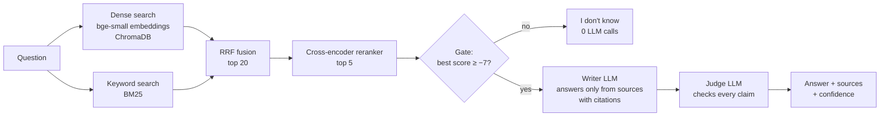

# Hybrid RAG over the FastAPI docs

A question-answering system for the FastAPI documentation. Every answer comes **only** from the docs, with citations and a fact-check of each claim. When the docs don't cover a question, it says **"I don't know"** instead of inventing an answer.

**Live demo:** https://hybrid-rag-vedu.streamlit.app/
<sub>Free hosting: if nobody has visited for 12 hours the app is asleep. Click "Yes, get this app back up!", and give the first question 1–2 minutes while the AI models load.</sub>


---

## Results at a glance

These numbers come from a 50-question test set: 40 questions the docs can answer and 10 they can't.

| Metric | Result |
|---|---|
| Correct answers, all 50 questions | **84%** |
| Correct answers, the 40 answerable questions | **80%** (28 correct, 8 partial, 4 wrong) |
| Honest "I don't know" on the 10 unanswerable questions | **10 / 10** (100%) |
| Faithfulness (share of claims backed by the cited sources) | **84%** |
| Retrieval hit@5 / MRR (right file in the top 5) | **85% / 0.70** |

What went wrong, and how the numbers were tuned, is covered in [Evaluation](#evaluation) below.

---

## Example answer


---

## How it works



| Step | What happens | Details |
|---|---|---|
| **1. Ingestion** | The FastAPI docs (156 Markdown pages) are loaded. Code placeholders are expanded with the real example code, and the text is split into chunks. | 800-character chunks with 100 overlap. Near-duplicates (≥0.98 similarity) and tiny chunks are removed. **2,667 chunks** in total. |
| **2. Hybrid search** | Two searches run side by side. Meaning-based search finds rephrased questions ("return a 404" ≈ `HTTPException`). Keyword search catches exact names like `OAuth2PasswordRequestForm`. | `BAAI/bge-small-en-v1.5` (384-dim) in ChromaDB, plus BM25. The two result lists are merged with **Reciprocal Rank Fusion** (k = 60), which only uses rank positions, so the two incompatible score scales never need to be compared. |
| **3. Reranking** | A cross-encoder reads the question *together with* each of the 20 candidates and keeps the best 5. | `cross-encoder/ms-marco-MiniLM-L-6-v2`. It is slower but more accurate than the embedding search, so it only runs on the shortlist. |
| **4. Gate** | If even the best chunk scores below a threshold, the system answers "I don't know" without calling the LLM. | The threshold is −7 (see the tuning note below). Off-topic questions cost **zero** LLM calls. |
| **5. Writer** | An LLM answers using **only** the 5 numbered sources, cites them as `[1]`, `[2]`, …, and must say "I don't know" if they don't contain the answer. | `openai/gpt-oss-120b` on Groq, temperature 0. Citation formats the model sometimes invents (`【1】`) are normalised in code. |
| **6. Judge** | A second LLM call splits the answer into claims and checks each one against the sources it cites. Code also flags citations that point to sources which don't exist. | **Confidence = share of claims confirmed.** HIGH ≥ 0.8, MEDIUM ≥ 0.5. |

The pipeline sits behind a **FastAPI** service (`POST /ask`, with input validated by Pydantic). A **Streamlit** page talks to it. **Docker Compose** runs both together.

---

## Evaluation

The test set is [`data/eval/questions.json`](data/eval/questions.json). It has 40 answerable questions across the tutorial, advanced, how-to, deployment and general sections. The other 10 can't be answered from the docs: 5 are clearly off-topic, and 5 are **near-misses** that sound like FastAPI questions but aren't covered (Celery, Sentry, Alembic, pytest-xdist, Prometheus). Each question has the expected source file(s) and a reference answer. The answer keys were checked by hand, and 4 of the 50 had to be corrected.

### Part A – retrieval only (no LLM calls)

I compared three chunking strategies:

| Chunking | Chunks | Hit@5 | MRR |
|---|---|---|---|
| **Fixed size (800 / 100)** | 2,667 | **85%** | **0.70** |
| By Markdown headings | 3,250 | 85% | 0.70 |
| Semantic (split where meaning shifts) | 2,755 | 82.5% | 0.66 |

They tie within noise, so the **simplest one was kept**.

### Part B – full answers (graded by an LLM against the reference answers)

| | Count | Actually correct |
|---|---|---|
| HIGH confidence | 23 | 20 (87%) |
| MEDIUM confidence | 10 | 5 |
| LOW confidence | 3 | 3 |
| Refused ("I don't know") | 14 | 10 of 10 unanswerable questions refused correctly. 4 answerable questions were wrongly refused. |

All 5 off-topic questions were stopped by the Gate, and all 5 near-misses were refused by the writer. HIGH is the only group big enough to trust. The MEDIUM and LOW groups are too small to read much into.

### What failed, and why

- **The 4 wrong answers were all honest refusals,** not hallucinations. In each case retrieval found the **right file but the wrong part of it**. For example, for *"How can I protect a route using OAuth2 password flow and retrieve the submitted username and password?"* search returned the first chunk of the right page (`simple-oauth2.md`), but `OAuth2PasswordRequestForm` only appears in a later chunk of that page. The weakness is in **retrieval**, not generation.
- **Hit@5 is measured per file, so it is generous.** It counts a hit when the right *file* appears, even if the chunk that holds the answer doesn't.
- **8 partial answers** were mostly incomplete rather than wrong. One reference answer was stricter than the docs themselves.

### Honest caveats

- **Two settings were tuned on the test set.** The Gate started at 1.0 and blocked 8 of 40 answerable questions, because the reranker scores correct code-heavy chunks below zero, so it was lowered to −7. Confidence originally mixed the reranker score with the judge's score, and the evaluation showed the reranker part pushed correct answers down to LOW, so it is now the judge's score only. Both changes were made from these results, so the numbers above are somewhat optimistic. A held-out test set would fix this.
- **Confidence measures "grounded", not "complete".** Three HIGH answers were only partially correct.
- **The LLM judge is not perfectly consistent.** The same answer can get a different confidence on different runs.
- **50 questions is a small sample.** Treat the percentages as rough.

### Ideas for improvement

- Pass each retrieved chunk's **neighbouring chunks** to the writer, to fix the cut-off failures.
- Measure retrieval at **chunk level**.
- Build a separate **held-out test set**.
- Run the judge more than once and average the results.

---

## Run it yourself

You need a free **Groq API key** from [console.groq.com](https://console.groq.com). Create a file called `.env` in the project folder:

```
GROQ_API_KEY=your_key_here
```

### Option A – Docker (recommended)

```bash
docker compose up --build
```

Then open **http://localhost:8501** for the web page, or **http://localhost:8000/docs** for the API's interactive docs. The first build downloads about 1 GB and takes several minutes. The API image (about 3 GB) has the models and the search database baked in. The key is passed in at start-up and never stored in the image.

### Option B – Python (3.12)

```bash
python -m venv .venv
.venv\Scripts\activate            # Windows  (macOS/Linux: source .venv/bin/activate)
pip install -r requirements.txt

uvicorn src.api.main:app --reload     # terminal 1 – the API on port 8000
streamlit run ui/app.py               # terminal 2 – the web page on port 8501
```

### Use the API directly

```bash
curl -X POST http://localhost:8000/ask \
     -H "Content-Type: application/json" \
     -d '{"question": "How do I add CORS to my app?"}'
```

The response contains `answer`, `answered`, `reason`, `confidence`, `level`, `sources` (the cited files), `checks` (each claim and whether the sources support it) and `bad_citations`. If the question is shorter than 3 or longer than 500 characters, the API returns **422**.

### Rebuild the search database (optional)

The built database (`chroma_db/`) is included in the repo. To rebuild it from scratch:

1. Clone the [FastAPI repository](https://github.com/fastapi/fastapi) **next to** this project as `../fastapi-src`. The code examples are pulled in from its `docs_src` folder.
2. Copy `../fastapi-src/docs/en/docs` into `data/raw`.
3. Run `python -m src.ingestion.build`. This builds all three chunking variants.

### Re-run the evaluation (optional)

```bash
python -m src.evaluation.retrieval_eval   # Part A – no LLM calls, a few minutes
python -m src.evaluation.run_eval         # Part B – about 3 LLM calls per question; respects Groq's free-tier limits, ~30 min
```

---

## Project structure

```
src/
  ingestion/    loader.py (md/txt/html/pdf + code-include expansion), chunker.py (3 strategies),
                dedup.py, embedder.py, store.py (ChromaDB), bm25_index.py, build.py
  retrieval/    hybrid.py (dense + BM25 + RRF), reranker.py (cross-encoder)
  generation/   prompt.py, llm.py (Groq, OpenAI-compatible), judge.py, answer.py (ask(): gate → writer → judge)
  evaluation/   retrieval_eval.py, grader.py, run_eval.py
  api/          main.py (FastAPI: GET /health, POST /ask)
ui/             app.py (Streamlit page), requirements.txt (for Streamlit Cloud)
data/eval/      questions.json + saved results
chroma_db/      the built vector database
Dockerfile, Dockerfile.ui, compose.yaml, requirements-api.txt, requirements-ui.txt
```

---

## Deployment notes

The live demo runs on **Streamlit Community Cloud**. It runs a single app, so `ui/app.py` has a **direct mode** (`RAG_DIRECT=1`) that calls `ask()` in the same process instead of going through the API. Locally and in Docker, the page talks to the FastAPI service.

Problems solved along the way:
- Hugging Face Docker Spaces now need a paid plan, and most free container hosts offer 512 MB of memory. This app needs about 1.2 GB (torch plus two models).
- The host's Linux ships **sqlite 3.34**, but ChromaDB needs ≥ 3.35. `pysqlite3-binary` is swapped in at start-up.
- The host's installer (uv) rejected PyTorch's CPU package index, so torch is pinned by its exact **CPU wheel URL**. This also avoids gigabytes of unused GPU libraries.
- A public link spends the Groq free allowance, so the demo has a **daily question limit** (150), and rate-limit errors become a friendly "please wait" message.

---

## Tech stack

Python 3.12 · ChromaDB · sentence-transformers (bge-small-en-v1.5, ms-marco-MiniLM cross-encoder) · rank-bm25 · Groq (gpt-oss-120b, via the OpenAI SDK) · FastAPI · Pydantic · Streamlit · Docker / Docker Compose

The documentation content comes from the [FastAPI project](https://github.com/fastapi/fastapi) (MIT License).
